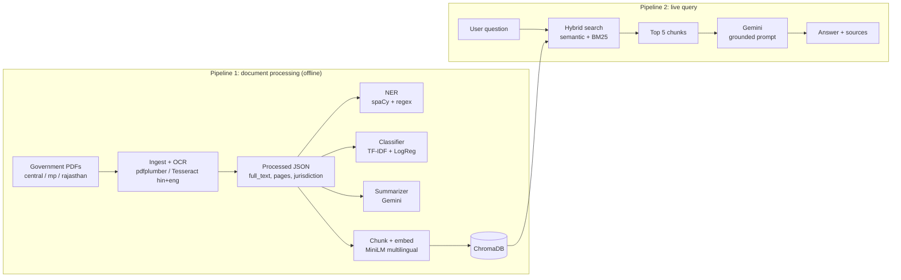

# JanSahayak (जनसहायक)

**An AI-powered government document intelligence platform for citizen services.**

Ask a question in English or Hindi and get an answer drawn only from real Central, Madhya Pradesh and Rajasthan government scheme documents, with the source files shown next to the answer. If the documents do not contain the answer, JanSahayak says so instead of guessing.

> **Disclaimer.** JanSahayak is a student capstone project (DSN4091, VIT Bhopal). It is **not** an official Government of India or State Government product. Scheme rules change and documents can be outdated. Always confirm eligibility and deadlines with the concerned authority.

---

## Table of contents

1. [Why this project exists](#why-this-project-exists)
2. [Features](#features)
3. [How it works](#how-it-works)
4. [Tech stack](#tech-stack)
5. [Project structure](#project-structure)
6. [Getting started](#getting-started)
7. [Running the data pipeline](#running-the-data-pipeline)
8. [Running the app](#running-the-app)
9. [API reference](#api-reference)
10. [Adding a new document](#adding-a-new-document)
11. [Data coverage](#data-coverage)
12. [Results](#results)
13. [Deployment](#deployment)
14. [Known issues and limitations](#known-issues-and-limitations)
15. [Roadmap](#roadmap)

---

## Why this project exists

Scheme guidelines, eligibility criteria and circulars are published as PDFs across many Central and State portals. They are often scanned, often in Hindi, and inconsistently formatted. A student asking "Can an orphan final-year engineering student apply for this scholarship?" has to open and read many long documents to find one clause.

The project is based on a Smart India Hackathon problem statement from the Government of Rajasthan asking for a language-agnostic citizen-service chatbot for government scheme information.

## Features

- **Natural-language Q&A** in English or Hindi, answered in the language of the question.
- **Grounded answers.** Gemini sees only the retrieved document chunks and is told to say "not available" when the answer is missing.
- **Source display.** Every answer is shown with the documents that were retrieved, tagged with jurisdiction (Central / MP / Rajasthan).
- **Hybrid retrieval.** Multilingual semantic search plus BM25 keyword search.
- **Scanned PDF support.** Automatic OCR fallback (Tesseract, Hindi + English).
- **Per-document enrichment.** Document classification, named entities, and short summaries.
- **Web interface.** Ask, Scheme Directory, Eligibility Screener and About pages, with a civic-portal look rather than a generic chat UI.

## How it works

JanSahayak is two pipelines that share one vector database.



**Ingestion.** `pdfplumber` extracts native text. If a page averages fewer than about 20 characters, the PDF is treated as scanned and each page is rendered at 300 DPI and read with Tesseract (`hin+eng`).

**Indexing.** Text is split into roughly 350-word chunks with a 50-word overlap. Each chunk is embedded with `paraphrase-multilingual-MiniLM-L12-v2` (384 dimensions) and stored in ChromaDB (cosine space) with filename, jurisdiction and chunk index.

**Retrieval.** For a question, cosine similarity is computed against all chunk vectors and BM25 scores are computed over the same chunks. Both are min-max normalised and combined (`0.5 * semantic + 0.5 * keyword`). The top 5 chunks are kept.

**Generation.** The chunks are placed in a prompt that tells Gemini to answer only from the context, state when information is missing, and reply in the user's language.

**Why hybrid?** For the query "scholarship for orphan students", semantic-only search ranked the correct document (AICTE Swanath Scholarship) **8th**, because "orphan" is a small part of a long document. Adding BM25 moved it to **1st**.

## Tech stack

| Layer | Technology |
|---|---|
| Language | Python 3.11 |
| PDF text | pdfplumber |
| OCR | Tesseract (`hin+eng`), pdf2image, Poppler |
| Embeddings | Sentence-Transformers `paraphrase-multilingual-MiniLM-L12-v2` |
| Vector store | ChromaDB (persistent, cosine) |
| Keyword search | rank_bm25 (BM25Okapi) |
| LLM | Google Gemini (`gemini-3.5-flash-lite`) |
| Classification | scikit-learn (TF-IDF + Logistic Regression) |
| NER | spaCy `en_core_web_sm` + custom regex |
| Backend | FastAPI, Uvicorn |
| Frontend | HTML, CSS, vanilla JavaScript, `marked` (Markdown rendering) |
| Hosting | GitHub, Render (backend), Netlify (frontend) |

## Project structure

```
JanSahayakAI/
├── backend/
│   ├── __init__.py
│   └── main.py                  # FastAPI app: /, /documents, /ask
├── frontend/
│   └── index.html               # Single-file UI (HTML + CSS + JS)
├── scripts/
│   ├── ingest.py                # PDFs -> text (OCR fallback) -> JSON
│   ├── check_data_quality.py    # Flags documents with empty/tiny text
│   ├── ner_extract.py           # Adds "entities" to each JSON
│   ├── summarize.py             # Adds "summary" to each JSON (Gemini)
│   ├── auto_label.py            # Keyword-rule guesses -> data/labels.csv
│   ├── train_classifier.py      # Trains classifier, adds "category" to each JSON
│   ├── build_vector_store.py    # Chunk + embed + store in ChromaDB
│   ├── hybrid_search.py         # CLI: hybrid retrieval only
│   ├── rag.py                   # CLI: full RAG loop in the terminal
│   └── test_search.py           # CLI: semantic-only search (baseline)
├── data/
│   ├── raw/                     # Input PDFs (git-ignored)
│   │   ├── central/
│   │   ├── mp/
│   │   └── rajasthan/
│   ├── processed/               # Output JSONs (git-ignored)
│   ├── vector_store/            # ChromaDB files (committed, ~43 MB)
│   ├── labels.csv               # Hand-corrected labels (git-ignored)
│   └── classifier_*.pkl         # Saved classifier (git-ignored)
├── requirements.txt             # Packages needed to serve the API
├── requirements_full.txt        # Packages needed to run the data pipeline
└── .gitignore
```

Each processed document is one JSON file:

```json
{
  "filename": "AICTE_3039_G.pdf",
  "jurisdiction": "central",
  "extraction_method": "text",
  "num_pages": 12,
  "full_text": "...",
  "pages": ["..."],
  "entities": {"language_note": "english_ner_applied", "people": [], "organizations": [],
               "dates": [], "locations": [], "money_amounts": [], "percentages": []},
  "summary": "...",
  "category": "scheme"
}
```

## Getting started

### Prerequisites

- **Python 3.11**
- **Tesseract OCR** with the Hindi and English language packs (`hin`, `eng`)
- **Poppler** (needed by `pdf2image`)
- A **Google Gemini API key** (the free tier works; see [limitations](#known-issues-and-limitations))

Tesseract and Poppler are only needed to *run the ingestion pipeline*. If you only want to serve the API from the committed vector store, you can skip them.

### Install

```bash
git clone <your-repo-url>
cd JanSahayakAI

python -m venv jansahayak-env
# Windows:  jansahayak-env\Scripts\activate
# macOS/Linux: source jansahayak-env/bin/activate

# Serve the API only:
pip install -r requirements.txt

# Or run everything (pipeline + API). Note the two files are complementary:
pip install -r requirements_full.txt -r requirements.txt
python -m spacy download en_core_web_sm
```

### Configure

Create a `.env` file in the project root (it is git-ignored, never commit it):

```
GEMINI_API_KEY=your_key_here
```

If you run the ingestion script, edit these two lines near the top of `scripts/ingest.py` to match your machine:

```python
TESSERACT_PATH = r"C:\Program Files\Tesseract-OCR\tesseract.exe"
POPPLER_PATH   = r"C:\path\to\poppler\Library\bin"
```

> **Folder names.** The scripts look for `central`, `mp` and `rajasthan` (lowercase) under `data/raw/` and `data/processed/`. This works on Windows regardless of case, but on Linux/macOS the folder names must be lowercase exactly.

## Running the data pipeline

You only need this when you add or change documents. Run from the project root:

```bash
python scripts/ingest.py               # 1. PDFs -> data/processed/*/*.json
python scripts/check_data_quality.py   # 2. Look for empty or tiny documents
python scripts/ner_extract.py          # 3. Add entities
python scripts/summarize.py            # 4. Add summaries (uses Gemini quota)
python scripts/auto_label.py           # 5. Write data/labels.csv with guessed labels
#    -> open data/labels.csv and correct the "predicted_label" column by hand
python scripts/train_classifier.py     # 6. Train classifier, add "category"
python scripts/build_vector_store.py   # 7. Rebuild the ChromaDB vector store
```

Things to know:

- `build_vector_store.py` deletes and recreates the collection each run (full rebuild, no incremental update).
- `summarize.py` skips documents that already have a summary and stops cleanly when the Gemini quota runs out. Re-run it later to continue.
- **`auto_label.py` overwrites `labels.csv`.** Keep a copy of your corrected labels before re-running it.
- Entities, summaries and categories are stored in the JSON files. They are **not** in ChromaDB, so the live API does not use them yet.

## Running the app

### Backend

```bash
uvicorn backend.main:app --reload --port 8000
```

On startup the server loads the embedding model, the vector store and the BM25 index into memory (this takes a moment). Then open `http://localhost:8000/docs` for the interactive API docs.

### Frontend

`frontend/index.html` is a single file with no build step. Check the constant near the top of its `<script>`:

```js
const API_BASE = "http://localhost:8000";   // change to your deployed backend URL for production
```

Then open `frontend/index.html` in a browser, or serve it with any static server. The page shows "Connected (Healthy)" when it can reach the backend.

### Command-line tools

```bash
python scripts/rag.py            # full question -> answer loop in the terminal
python scripts/hybrid_search.py  # show top-5 hybrid matches with scores
python scripts/test_search.py    # semantic-only baseline (for comparison)
```

## API reference

CORS is open (`*`) so a separately hosted frontend can call the API.

### `GET /`

Health check.

```json
{ "status": "JanSahayak API chal raha hai", "total_chunks": 2128 }
```

### `GET /documents`

Unique indexed documents, sorted by jurisdiction then filename.

```json
{
  "total": 63,
  "documents": [
    { "filename": "AICTE_3039_G.pdf", "jurisdiction": "central" }
  ]
}
```

### `POST /ask`

```bash
curl -X POST http://localhost:8000/ask \
  -H "Content-Type: application/json" \
  -d '{"question": "scholarship for orphan students"}'
```

```json
{
  "answer": "…answer text in the language of the question…",
  "sources": [
    { "filename": "AICTE_3039_G.pdf", "jurisdiction": "central" }
  ]
}
```

`sources` lists the unique documents among the top 5 retrieved chunks, in rank order. It reflects what was **retrieved**, not necessarily what the model quoted.

## Adding a new document

1. Put the PDF in `data/raw/<central|mp|rajasthan>/`.
2. Run the [pipeline](#running-the-data-pipeline) (at minimum `ingest.py`, `check_data_quality.py`, and `build_vector_store.py`).
3. Commit the updated `data/vector_store/` and redeploy the backend.

To add a new state, create a new folder and add its name to the `JURISDICTIONS` list in each script (the list is repeated in several files). The jurisdiction tag then flows through search and citations automatically.

## Data coverage

63 real, publicly available documents, 2,128 chunks.

| Jurisdiction | Documents | Notes |
|---|---|---|
| Central | 41 | Education and scholarships (AICTE, UGC, NMMSS, ICAR, RUSA, PM-USHA), Health (Ayushman Bharat, Janani Suraksha Yojana, CGHS), Agriculture (PM-KISAN, PMFBY, PMKSY, PKVY, RKVY, eNAM, Kisan Credit Card) |
| Madhya Pradesh | 12 | State scholarship scheme documents (all scanned, OCR) |
| Rajasthan | 10 | Higher-education department circulars and schemes (many in Hindi) |

42 documents have native text and 21 needed OCR.

## Results

These come from targeted manual testing, not a formal benchmark.

| Check | Result |
|---|---|
| Hybrid vs semantic-only ("scholarship for orphan students") | Correct document rank **8th → 1st** |
| Hindi OCR | English-only OCR produced garbled text; adding `hin+eng` fixed it |
| Document classifier (TF-IDF + Logistic Regression) | **85%** accuracy on a 13-document held-out split |
| NER on Hindi-dominant documents | English spaCy skipped (it tagged Hindi words as people); regex for money and percentages used instead |

The classifier numbers are rough: the dataset is 63 documents and the "circular" class (3 examples) is barely learned. A formal evaluation set (questions with expected source documents) is planned.

## Deployment

| Component | Host | Notes |
|---|---|---|
| Code | GitHub | `.env` and raw/processed data are git-ignored. The ~43 MB vector store is committed. |
| Backend | Render (free tier) | Set `GEMINI_API_KEY` as a secret environment variable. Start command: `uvicorn backend.main:app --host 0.0.0.0 --port $PORT` |
| Frontend | Netlify | Change `API_BASE` in `index.html` to the Render URL, then upload the `frontend/` folder. |

- **Memory.** The Render free tier has 512 MB of RAM, which is not enough for PyTorch with `sentence-transformers`. The deployed backend runs the same MiniLM model through [FastEmbed](https://github.com/qdrant/fastembed) (ONNX), without PyTorch. Use the same model on both the build and serve sides so vectors stay compatible.
- **Cold starts.** Free Render instances sleep after about 15 minutes idle, so the first request can take 50+ seconds. Open the site a few minutes before a demo.
- **Secrets.** Never commit `.env`. If a key is ever committed, revoke it and create a new one.

## Known issues and limitations

- **Hindi keyword matching is weak.** The BM25 tokenizer uses `re.findall(r"\w+", ...)`, which splits Devanagari words at vowel marks. Use `r"[\w\u0900-\u097F]+"` in `hybrid_retrieve`/`tokenize` (it is defined in `rag.py`, `hybrid_search.py` and `backend/main.py`) and restart the backend.
- **Romanised Hindi (Hinglish) and typo-heavy queries** retrieve poorly.
- **Sources are retrieved documents**, so the list can include files the answer did not use.
- **Jurisdiction checkboxes** in the UI filter the Scheme Directory only; they are not sent to `/ask`.
- **Eligibility Screener** turns the form into a natural-language question for the same RAG pipeline. It is not a rules engine, and its output is not an official determination.
- **NER** is reliable only on English-majority documents, and the small spaCy model is noisy even there.
- **NER, classification and summaries** are stored per document but not yet used in answers or the UI.
- **Knowledge limit.** Only the 63 indexed documents can be answered. Some are older revisions.
- **Data quality.** One Rajasthan document is indexed twice (identical text), and a few PDFs contain font-encoding junk (`(cid:123)`), so part of their text is unreadable.
- **Free-tier limits.** Gemini free-tier daily and per-minute quotas apply (regular Flash allowed about 20 requests/day in our testing; Flash-Lite about 500/day), and `google-generativeai` is a deprecated library.
- **Privacy.** The system stores no user data, but questions are sent to the Gemini API, a third-party service.

## Roadmap

- Query rewriting for typos and romanised Hindi
- Show only the sources the answer actually cites
- Use NER, categories and summaries in the UI and as search filters
- A rules-based eligibility engine alongside the RAG assessment
- A formal evaluation set (30–40 questions across jurisdictions and domains, including Hindi)
- Hindi/multilingual NER model
- More states and domains
- Authenticated admin upload that runs the ingestion pipeline
- Migrate to the current Google Gemini SDK


B.Tech CSE (AI & ML), School of Computing Science and Engineering, VIT Bhopal University.


